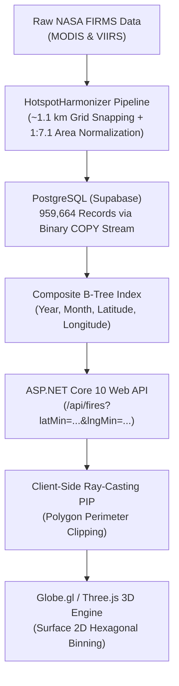

# Balkan Wildfire Calendar
### Harmonization of NASA MODIS and VIIRS Thermal Hot Spots (2000–2026)

The **Balkan Wildfire Calendar** is an interactive 3D geospatial analytics platform designed to visualize, filter, and analyze 26 years of wildfire activity across Southeastern Europe. 

By harmonizing nearly 1,000,000 thermal anomaly records from two distinct NASA satellite instruments (MODIS and VIIRS), the platform resolves sensor discrepancies and enables researchers and emergency planners to draw, edit, and query custom geographic boundaries anywhere across the Balkans in real time.

---

## Table of Contents
- [The Challenge: Instrument Discrepancy](#the-challenge-instrument-discrepancy)
- [Key Features](#key-features)
- [Harmonization Methodology](#harmonization-methodology)
- [System Architecture](#system-architecture)
- [Colorblind Accessibility](#colorblind-accessibility)
- [Getting Started](#getting-started)
- [Technical Specifications](#technical-specifications)
- [License](#license)

---

## The Challenge: Instrument Discrepancy

NASA operates two primary thermal observation sensors:
- **MODIS** (Terra and Aqua satellites, operational since 2000) provides a 26-year historical baseline at **1 km spatial resolution**.
- **VIIRS** (Suomi-NPP and NOAA-20, operational since 2012) offers modern observation at **375 m spatial resolution**.

### The Problem
Directly combining raw VIIRS data with MODIS records creates artificial inflation in recent wildfire statistics. Because VIIRS operates at a finer spatial resolution and lower thermal detection threshold, it detects smaller, lower-temperature fires that MODIS missed. Without harmonization, multi-decade longitudinal studies show false increases in fire occurrence.

### The Solution
The Balkan Wildfire Calendar harmonizes both datasets by binning detections into an equal-area ~1.1 km spatial-temporal grid and applying a physical pixel-area normalization factor to normalize event counts across both eras.

---

## Key Features

### 1. Interactive 3D Digital Twin
- 3D planetary rendering built on Globe.gl and Three.js, streaming high-resolution ArcGIS World Imagery with realistic atmospheric scattering.
- Unconstrained orbiting, panning, and close-range inspection of localized valleys, mountain passes, and border regions.

### 2. Freeform Vector Geographic Drawing
- Freehand polygon selection directly on the 3D globe surface.
- Screen-space mouse clicks are projected into geographic coordinates via spherical raycasting.
- **Draggable Vertex Handles**: Grab and reposition any vertex point in real time; spatial queries and fire counts recalculate dynamically upon release.
- **Undo and Reset**: Single-vertex undo and full selection reset controls.

### 3. Surface-Flush 2D Hexagonal Binning
- Avoids perspective distortion and occlusion associated with 3D vertical pillars or spikes.
- Hexagonal cells conform to Earth's spherical curvature (curvature resolution of 8) and sit flush on the surface (altitude: 0.0002).
- Density shading visualizes fire frequency, weighted by Fire Radiative Power (FRP) in Megawatts.

### 4. Two-Tier Spatial Filtering
- **Server-Side**: A multi-column composite B-tree index on `(Year, Month, Latitude, Longitude)` narrows 960,000 database rows to a candidate bounding box in under 50 milliseconds.
- **Client-Side**: Ray-casting Point-In-Polygon (PIP) filtering excludes candidate points outside the polygon perimeter in under 5 milliseconds, ensuring 100% boundary accuracy.

---

## Harmonization Methodology

Because a single 1 km MODIS pixel covers approximately 7.1 times the surface area of a 375 m VIIRS pixel:

$$\text{Pixel Area Ratio} = \frac{1000\text{ m} \times 1000\text{ m}}{375\text{ m} \times 375\text{ m}} = \frac{1{,}000{,}000\text{ m}^2}{140{,}625\text{ m}^2} \approx 7.11$$

The normalized fire detection count for any spatial grid cell $(x, y)$ in year $Y$ and month $M$ is computed as:

$$\text{HarmonizedCount} = \text{ModisCount} + \left(\frac{\text{ViirsCount}}{7.1}\right)$$

Total thermal output is preserved additively through Fire Radiative Power (FRP):

$$\text{TotalFRP} = \sum_{i=1}^{N} \text{FRP}_i \quad [\text{MW}]$$

---

## Colorblind Accessibility

Approximately 8% of men and 0.5% of women have red-green color vision deficiency (deuteranopia or protanopia), making standard red fire maps difficult to interpret.

The application includes selectable, scientifically calibrated color palettes:
- **Classic Fire (Red Ramp)**: High-contrast coral to crimson to dark maroon.
- **Cividis (Colorblind Safe)**: Yellow-gold to slate gray to deep navy. Engineered with strictly monotonic luminance, ensuring that darker colors consistently represent denser fire clusters for all viewers.
- **Viridis (High Contrast)**: Radiant yellow to green to teal to deep purple.

---

## System Architecture



---

## Getting Started

### Prerequisites
- [.NET 10.0 SDK](https://dotnet.microsoft.com/download/dotnet/10.0)
- PostgreSQL database instance (or Supabase connection string)

### 1. Clone the Repository
```bash
git clone https://github.com/1achezar/Harmonization-of-MODIS-and-VIIRS-Hot-Spots.git
cd Harmonization-of-MODIS-and-VIIRS-Hot-Spots
```

### 2. Configure Database Connection
Set your PostgreSQL connection string in `Harmonization of MODIS and VIIRS Hot Spots/appsettings.json`:
```json
{
  "ConnectionStrings": {
    "DefaultConnection": "Host=your-host;Port=5432;Database=postgres;Username=postgres;Password=your-password;"
  }
}
```

### 3. Run the Application
```bash
dotnet run --project "Harmonization of MODIS and VIIRS Hot Spots"
```
Open `http://localhost:5221` in your browser.

---

## Technical Specifications

| Layer | Technologies |
| :--- | :--- |
| **Backend & API** | C#, ASP.NET Core 10, Entity Framework Core, Npgsql |
| **Database** | PostgreSQL (Supabase), Binary `COPY` protocol, Multi-column B-tree indexing |
| **3D Engine** | Globe.gl, Three.js, CSS2DRenderer, HTML5 Canvas |
| **Frontend & UI** | Tailwind CSS, Lucide Icons, Google Fonts (*Inter*, *JetBrains Mono*) |
| **Data Sources** | NASA FIRMS (MODIS Aqua/Terra, VIIRS Suomi-NPP/NOAA-20), ArcGIS World Imagery |

---

## License
Developed for the **NASA Space Apps Challenge**. All NASA active fire data is provided courtesy of the NASA FIRMS (Fire Information for Resource Management System) initiative.
